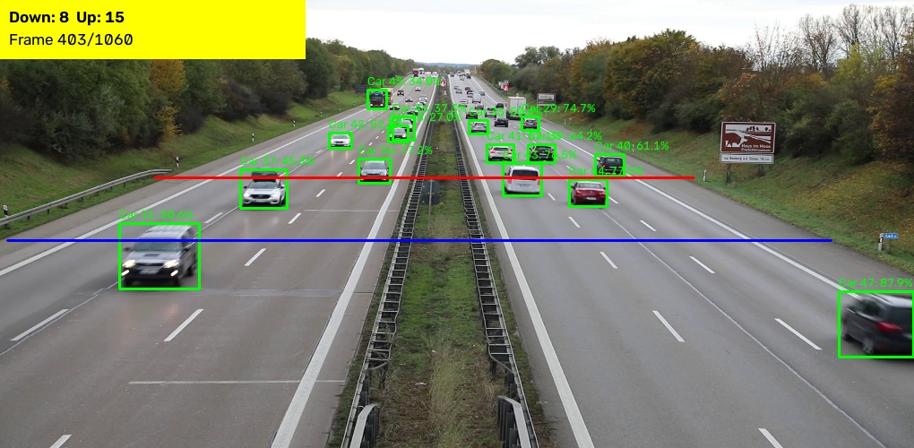

# Car Speed Detection

## Dataset Download Report

Executed successfully on November 26, 2026 (exit code 0):

```python
import kagglehub

path = kagglehub.dataset_download("guisahanes/traffic-violation-detection-dataset")
print("Path to dataset files:", path)
```

The run used `KAGGLEHUB_CACHE` set to this project's `.cache/kagglehub` directory and resolved dataset version **1**. The existing cached dataset was reused.

```text
Path to dataset files: /home/sakilans/Documents/Project/ML/car_speed_detection/.cache/kagglehub/datasets/guisahanes/traffic-violation-detection-dataset/versions/1
```

Verified downloaded file counts:

| Directory    | Files |
| ------------ | ----: |
| images/train | 5,254 |
| images/val   | 1,470 |
| labels/train | 5,254 |
| labels/val   | 1,470 |

KaggleHub printed an outdated-version warning for installed version `0.3.13`; execution still succeeded. This report covers the dataset download code only. The notebook execution is reported below.

## Notebook execution report

Executed the repaired `main.ipynb` on November 26, 2026 using CPU inference, pretrained YOLOv8s, a 25% confidence threshold, and the complete `highway.mp4` (42.4 seconds at 25 FPS). The Kaggle dataset was not used for training or validation in this run.

| Measurement                                   |            Result |
| --------------------------------------------- | ----------------: |
| Frames processed                              |     1,060 / 1,060 |
| Video processing completion                   |           100.00% |
| Frames containing at least one detected car   |   1,060 (100.00%) |
| Mean car detection confidence                 |            61.10% |
| Car detections across all frames              |             9,285 |
| Downward crossing events                      |                29 |
| Upward crossing events                        |                28 |
| Total crossing events                         |                57 |
| Mean estimated crossing speed                 |        33.66 km/h |
| Estimated crossing speed range                | 20.80–46.14 km/h |
| Processing runtime (excluding model loading)  |     93.41 seconds |
| Detection accuracy / precision / recall / mAP |      Not measured |

**Percentages are not accuracy scores.** Completion is processed frames divided by video frame count. Frame coverage is frames with a detected car divided by processed frames. Mean confidence averages YOLO confidence over all car detections, including repeated observations of the same car. Accuracy requires matching predictions against ground-truth annotations; this video has no supplied annotated evaluation.

### Result image

The sample is the first frame with the highest number of detected cars. Boxes show tracker IDs and model confidence percentages. The counters show crossing totals up to that frame, rather than the final video totals.



### Artifacts and execution changes

- [Executed notebook with saved outputs](main.ipynb)
- [Full annotated video](reports/output.avi)
- [Raw metrics and individual speed estimates](reports/metrics.json)
- [Added centroid tracker](tracker.py)
- [Dependency versions](requirements.txt)

The notebook was repaired before execution: missing tracker code was added, duplicate loops were removed, and GUI windows were replaced with saved artifacts. Speed uses interpolated line-crossing times from video timestamps instead of machine processing time. The output video preserves the source 25 FPS and uses a separate report path.

Speeds assume **10 meters** between the red and blue lines; that distance has not been calibrated against the scene. Perspective, detection jitter, and centroid tracker ID switches can affect speed estimates and crossing counts. These are experimental estimates, with no measured speed accuracy. The detector processes only the COCO car class, so trucks and buses are excluded.

To rerun, select the project `.venv/bin/python` as the notebook kernel and run all cells. For a fresh environment, install CPU PyTorch from `https://download.pytorch.org/whl/cpu`, then install `requirements.txt`. The first run downloads `yolov8s.pt` if absent.
